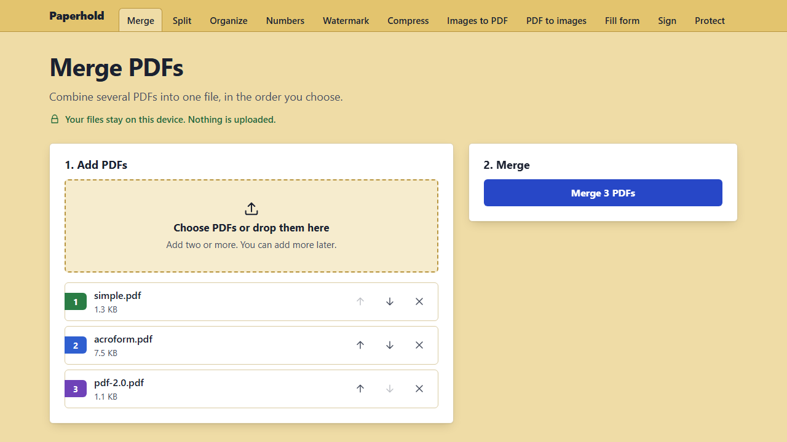

# Paperhold

Free, open-source PDF tools that run **entirely in your browser**. Merge, split, compress,
convert, sign, and OCR PDFs without installing anything and without uploading your files to
anyone, including us.



> Live at [paperhold.app](https://paperhold.app). Forks can rename or re-domain the site by
> editing `apps/web/site.config.ts` (one file); see [docs/LAUNCH.md](docs/LAUNCH.md).

## Why you can trust it with private documents

- Every operation runs on your device in Web Workers (pdf-lib, pdf.js, qpdf, tesseract.js).
- The site is served with a strict Content Security Policy: `connect-src 'self'`. Even if a
  dependency were compromised, the page cannot open a connection to another host.
- Our end-to-end tests fail the build if any request leaves our origin or carries more than
  1 KB, and if any CSP violation occurs.
- Check it yourself: open DevTools, Network tab, run a tool, and watch nothing get uploaded.
  The site's `/privacy` page walks through it.

## Tools

Merge, Split, Organize pages (reorder, rotate, delete), Page numbers, Watermark, Compress,
Images to PDF (JPG, PNG, HEIC and more), PDF to images, Fill form, Sign (visual signature),
Protect and Unlock (AES-256), and OCR (make scans searchable). Every tool works offline after
your first visit.

See [docs/STATUS.md](docs/STATUS.md) for exactly what is done and verified.

## Run it locally (4 commands)

```sh
git clone https://github.com/AsaPefferman-UI/paperhold.git && cd paperhold
corepack pnpm install          # or: npx pnpm@10.34.9 install
corepack pnpm build
corepack pnpm preview          # http://localhost:3103 with production headers
```

For development, `corepack pnpm dev`. Tests: `pnpm test` (unit) and `pnpm test:e2e` (Playwright,
after `pnpm build` and `pnpm exec playwright install`).

## Self-host

```sh
docker compose up --build      # http://localhost:8080
```

The image is unprivileged nginx serving the static build with the same security headers as
production. Optional build-time settings are documented in `.env.example` (an analytics origin
and the public URL for the sitemap). There are no secrets and no server-side state.

It also deploys to any static host. For Cloudflare Pages, the build emits `_headers`; see
[docs/deploy.md](docs/deploy.md).

## Project layout

```
apps/web         Vite + React app, Web Worker pool, build plugin, e2e tests
packages/core    Pure PDF operations + typed worker protocol, unit tested in Node
scripts          Licence check, launch check, image generation, Lighthouse gate
docs             Architecture guide, status, launch and deploy docs, ADRs
```

New to the code? Start with [docs/ARCHITECTURE.md](docs/ARCHITECTURE.md): how an operation flows
from the page to a worker, how to add a tool, and how to upgrade the self-hosted engines. The
[docs index](docs/README.md) says which documents are current.

## Contributing and security

Read [CONTRIBUTING.md](CONTRIBUTING.md). Report vulnerabilities privately as described in
[SECURITY.md](SECURITY.md).

## License

[AGPL-3.0-only](LICENSE). Third-party components are listed in
[THIRD_PARTY_NOTICES.md](THIRD_PARTY_NOTICES.md).
